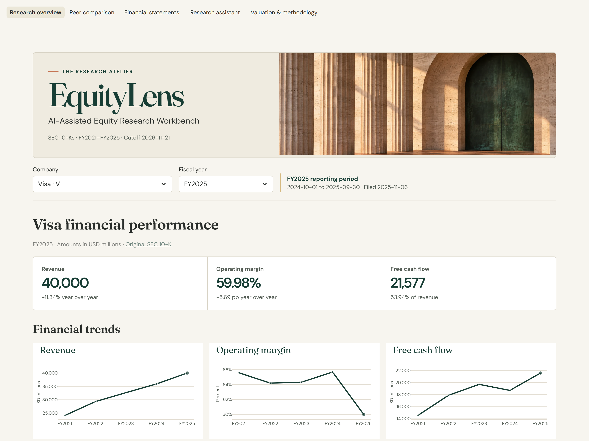
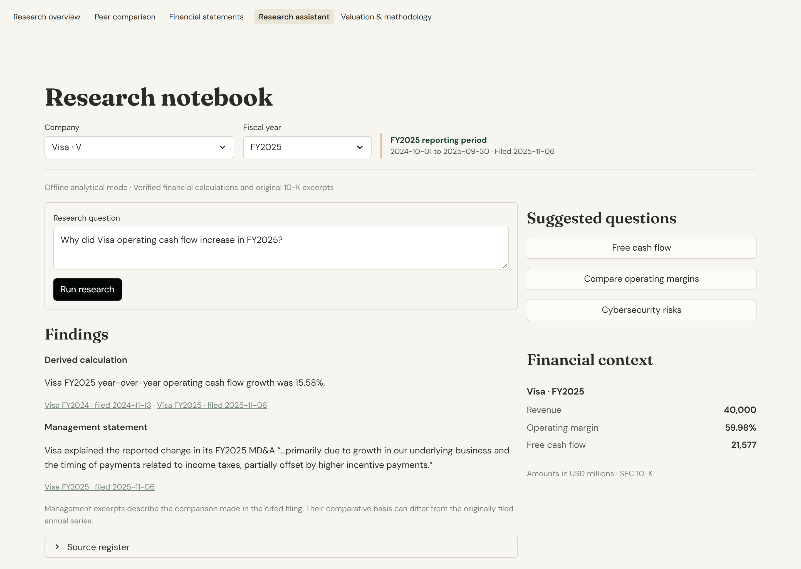

# EquityLens

**Evidence-Backed Equity Research & Financial Intelligence**

**Which payment companies are turning revenue growth into sustainable profitability and cash generation and how reliable are the financial comparisons behind that conclusion?**

EquityLens investigates this question across Visa, Mastercard, and PayPal from FY2021 through FY2025. It tracks growth consistency, operating profitability, cash generation, and asset efficiency across different payments business models. Analysts can check which fiscal periods and accounting concepts underpin a comparison and trace figures to the original SEC disclosures.

> **[🚀 Launch Live Dashboard](https://equitylens-ywwjzfgfgt8uubb88mgtbk.streamlit.app/)**
>
> The dashboard is public and opens without a sign-in. [Run it locally](#run-locally)

   

### Explore the Interactive Dashboard

Start with the peer comparison to see where growth, margins, and cash generation diverge. Open the statement explorer to verify a figure or use the research notebook to find relevant filing excerpts.

## Why this project?

Headline revenue, margins, and earnings can obscure whether growth converts into cash or comes with trade-offs in profitability and asset efficiency. Different fiscal year-ends, accounting concepts, and revisions in later filings can also change what appears comparable. EquityLens makes the comparison reproducible by preserving reporting dates, calculation inputs, and filing references so analysts can verify the figures and decide where to investigate further. Investment recommendations fall outside the scope of the workbench.

## Why Visa, Mastercard, and PayPal?

Visa and Mastercard provide a comparison between two major payments networks. PayPal adds a digital payments platform serving consumers and merchants across payment networks. The group lets analysts compare performance within a similar model and see where the picture changes across models. Differences in growth, margins, and cash flow warrant follow-up on business mix and reporting definitions before drawing conclusions. [Visa FY2025 10-K](https://www.sec.gov/Archives/edgar/data/1403161/000140316125000089/v-20250930.htm) · [Mastercard FY2025 10-K](https://www.sec.gov/Archives/edgar/data/1141391/000114139126000013/ma-20251231.htm) · [PayPal FY2025 10-K](https://www.sec.gov/Archives/edgar/data/1633917/000163391726000024/pypl-20251231.htm)

## What works today

- **Research overview and peer comparison** help analysts assess the consistency of revenue growth, benchmark margins and asset efficiency, and examine how accounting performance translates into operating and free cash flow. Each comparison shows the actual fiscal date ranges.
- **Financial statement explorer** lets analysts verify a figure before carrying it into a model or research note. It exposes formulas, XBRL concepts, filing accessions, dates, and signed calculation inputs, with exports for both comparisons and source lineage.
- **Research notebook** pairs deterministic SQL-backed answers with excerpts from original 10-Ks to show how management described a financial change. It labels reported facts, calculations, management statements, and hypothetical scenarios, and abstains on unsupported questions. The deployed assistant makes no model calls.
- **Valuation and methodology** shows how hypothetical growth, forecast horizon, discount rate, and terminal growth change the illustrative present value of a cash-flow proxy. The sensitivity uses the validated analytics and serves as a scenario exercise.

[Peer comparison](docs/screenshots/peer-comparison.png) · [Statement explorer](docs/screenshots/statement-lineage.png) · [Valuation scenarios](docs/screenshots/valuation.png)

## What the financial analysis found

- **Visa** led FY2025 operating margin at **59.98%** and free cash flow at **$21.577 billion**. The cash flow statement shows $23.059 billion of operating cash flow and $1.482 billion of capital purchases under the mapped line. [Visa FY2025 10-K](https://www.sec.gov/Archives/edgar/data/1403161/000140316125000089/v-20250930.htm)
- **Mastercard** led FY2021–FY2025 revenue CAGR at **14.79%** and FY2025 return on average assets at **29.28%** in this peer set. FY2025 revenue and operating income were $32.791 billion and $18.897 billion. [Mastercard FY2021 10-K](https://www.sec.gov/Archives/edgar/data/1141391/000114139122000023/ma-20211231.htm) · [Mastercard FY2025 10-K](https://www.sec.gov/Archives/edgar/data/1141391/000114139126000013/ma-20251231.htm)
- **PayPal** generated **$5.564 billion** of FY2025 free cash flow under the mapped definition. FY2021 operating cash flow appeared as $6.340 billion in the original filing and $5.797 billion in later comparative disclosures. EquityLens retains each version with its own citation. [PayPal FY2025 10-K](https://www.sec.gov/Archives/edgar/data/1633917/000163391726000024/pypl-20251231.htm) · [PayPal FY2021 10-K](https://www.sec.gov/Archives/edgar/data/1633917/000163391722000027/pypl-20211231.htm) · [PayPal FY2022 10-K](https://www.sec.gov/Archives/edgar/data/1633917/000163391723000033/pypl-20221231.htm)

Visa closes September 30. Mastercard and PayPal close December 31. FY labels align reporting years for exploration while the interface preserves each issuer’s actual dates.

## Architecture and data engineering

~~~mermaid
flowchart LR
    A[SEC Company Facts and Submissions] --> B[Cached JSON and hash manifest]
    B --> C[DuckDB source warehouse and XBRL lineage]
    C --> D[DuckDB statements and financial analytics]
    C --> E[Original 10-K identification]
    E --> F[HTML section extraction and SQLite FTS5]
    D --> G[Deterministic research answers]
    F --> G
    D --> H[Streamlit workbench]
    G --> H
~~~

1. **Ingest.** Python downloads SEC Company Facts, submissions and ticker mappings. The client validates responses, caches their original bytes, and uses an identifying User-Agent for live requests. The frozen artifacts have a November 21, 2026 filing-date cutoff and SHA-256 manifests. [SEC EDGAR APIs](https://www.sec.gov/search-filings/edgar-application-programming-interfaces) · [SEC fair access guidance](https://www.sec.gov/search-filings/edgar-search-assistance/accessing-edgar-data)
2. **Standardize.** DuckDB aligns 15 company-years to submitted annual 10-K accessions and fiscal windows. Issuer-specific XBRL mappings preserve units, duration or instant context, and source accession. The source warehouse contains 72,975 raw facts and a 225-slot standardized metric grid. Unavailable values remain null. [Data policy](docs/data-policy.md) · [Initial reconciliation](reports/validation-2026-11-21.md)
3. **Calculate.** SQL derives margins, growth, cash conversion, free cash flow, and returns on assets. Revenue growth uses the previous contiguous fiscal year. ROA uses average opening and closing assets reported in the same 10-K. FCF subtracts mapped capital purchases from operating cash flow. The analytics warehouse stores 215 source-lineage rows. [Formula dictionary](docs/financial-ratios.md) · [Analytics validation](reports/financial-analytics-validation.md)
4. **Index and answer.** The parser verifies the issuer, form and period of 15 original 10-Ks, then indexes 2,827 passages from Business, Risk Factors, and MD&A. SQLite FTS5 retrieves text by issuer, year and section. Python rules assemble typed claims and citations. Numeric evidence comes from DuckDB and management explanations come from cited excerpts. [Research architecture and limits](docs/research-assistant.md)

## Responsible AI and evaluation

The operational research mode is **offline and deterministic**. It requires no API key and makes no model calls. The implementation separates retrieval, factual claims, citations, and presentation into typed interfaces that could support later model integration. Any future generated narrative would need explicit evaluation against the same cited evidence.

The evaluation checks numeric answers, claim types, filing accessions, citation metadata, and whether excerpts occur at their cited position. Coverage includes missing values, unsupported questions, comparative revisions, and mismatched fiscal periods. The final audit also reconciled selected FY2025 metrics to their original filings and rebuilt the snapshot offline. [Final review and validation](reports/portfolio-review.md)

### How this differs from a conventional dashboard

The workbench puts reconciliation in the analyst’s workflow. A comparison can be traced to its original filing and accounting concept, exported with lineage, and supplemented with the relevant management disclosure. A missing or incomparable value stays visible as a research gap.

## Run locally

From the repository root on Windows with Python 3.12, install the pinned dependencies and rebuild the three local data stores from bundled sources. This path requires neither an SEC contact address nor network access after dependency installation.

~~~powershell
python -m venv .venv
$py = '.\.venv\Scripts\python.exe'
& $py -m pip install -r requirements.txt
Expand-Archive data/snapshots/2026-11-21-sec-json.zip data/frozen-2026-11-21
Expand-Archive data/snapshots/2026-11-21-sec-10k-html.zip data/frozen-10ks-2026-11-21
& $py -m src.equitylens --offline --cache data/frozen-2026-11-21 --verify-manifest data/snapshots/2026-11-21-source-manifest.json
& $py -m src.equitylens.analytics
& $py -m src.equitylens.research index --offline --cache data/frozen-10ks-2026-11-21 --verify-manifest data/snapshots/2026-11-21-10k-manifest.json
& $py -m pytest -q
& $py -m src.equitylens.research_eval
& $py -m streamlit run app/main.py --server.address 127.0.0.1 --server.port 8514
~~~

Keep the terminal open and visit [EquityLens on localhost](http://127.0.0.1:8514). For a live refresh, copy the [environment template](.env.example) to a private local environment file, supply an SEC contact address, and run the refresh command. Choose separate cache, database and report paths when experimenting with refreshed data so the demonstration remains reproducible. [Manual SEC download instructions](docs/sec-download.md)

~~~powershell
& $py -m src.equitylens --refresh --cache data/raw/refresh --database data/warehouse/refresh.duckdb --reports reports/generated/refresh
~~~

The repository retains about 5 MB of compressed public source inputs. Extracted caches, warehouses, generated reports, and local environment files are ignored. Fraunces and DM Sans are bundled with their OFL notices. The overview illustration was generated with ImageGen.

## Public deployment

EquityLens runs on Streamlit Community Cloud from `app/main.py` using Python 3.12. When the local data stores are missing, startup rebuilds the two DuckDB databases and the SQLite filing index from the bundled SEC snapshots and verifies their manifests. The build runs offline and requires no SEC contact address or AI key.

## Limitations and next steps

- The snapshot covers three issuers and annual filings through FY2025. Peer windows differ by issuer, and taxonomy gaps can prevent complete comparisons. PayPal’s combined mapped debt remains blank because its current component is unavailable.
- Text retrieval is lexical and limited to three 10-K sections. Numeric results use approved metric and period rules. Table reasoning, broader issuer coverage, quarterly reports, and freer-form questions need additional ingestion, mapping, and evaluation.
- The DCF is a sensitivity exercise on a free-cash-flow proxy. Equity value per share would require adjustments for financing, excess cash, share count, and a fit-for-purpose cash flow definition.
- Future work includes broader filing coverage, stronger question understanding, and a separately evaluated optional model layer.

[FAQ](docs/showcase.md) · [Final audit and remaining limitations](reports/portfolio-review.md)
